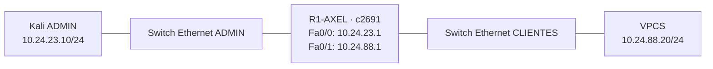

# Video demostrativo

(https://youtu.be/rwQ6xQ5vtus)

# Hardening de Cisco IOS 12 en GNS3

**Autor:** Axel Enrique Vasquez Peña · **Matrícula:** 2024-2388 · **Práctica:** A4

**Estado:** laboratorio ejecutado; hardening aplicado y guardado. Diez controles pasan también después del reinicio. Video personal pendiente.

## Propósito

Reducir la exposición del plano de administración de un router: retirar Telnet, exigir SSHv2, limitar sesiones inactivas e intentos de autenticación, desactivar AUX y CDP y limpiar conexiones TCP abandonadas. Comprobar que la administración SSH y el enrutamiento siguen funcionando.

Se utiliza un Cisco c2691, Kali Linux, dos switches Ethernet de GNS3 y un cliente VPCS. El análisis automatizado evalúa **diez recomendaciones seleccionadas**, no el cumplimiento completo del benchmark.


## Resultados reales

| Comprobación | Antes | Después |
|---|---|---|
| Controles CIS seleccionados | 0/10 PASS | 10/10 PASS |
| TCP 23 / Telnet | Abierto | Cerrado |
| TCP 22 / SSH | Abierto, modo 1.99 | Abierto, SSHv2 |
| Ping Kali → VPCS | 5/5 respuestas | 5/5 respuestas |
| Segunda aplicación | — | Sin comandos correctivos |
| Auditoría tras reinicio | — | 10/10 PASS |

La auditoría sin cambios produjo hashes idénticos del running-config. La prueba de autenticación cerró la conexión tras dos contraseñas incorrectas y cerró una autenticación incompleta a los 60,14 segundos. Las sesiones inactivas finalizaron a los **300,59 s por SSH** y **300,69 s por consola**. [Ver resultados y archivos fuente](docs/04-pruebas.md).




## Documentación

**Proyecto GNS3:** [A4-CIS-2024-2388.gns3](gns3/A4-CIS-2024-2388.gns3). Consultar [cómo abrirlo](gns3/README.md). La topología también está creada en la carpeta local de proyectos de GNS3.

1. [Montaje paso a paso](docs/01-montaje.md)
2. [Benchmark, controles y justificación](docs/02-controles-cis.md)
3. [Auditoría, aplicación y recuperación](docs/03-operacion.md)
4. [Pruebas y evidencias](docs/04-pruebas.md)
5. [Video y entrega](docs/05-entrega.md)
6. [Uso del laboratorio ya instalado](docs/06-uso-instalado.md)


## Herramienta

`scripts/cis_ios.py`: auditor propio en Python/Netmiko, basado en CIS Cisco IOS 12 v4.0.0. Recorre los dispositivos del inventario, consulta configuración y estado SSH, genera informes JSON/Markdown, y permite corregir los controles seleccionados. No es CIS-CAT ni una herramienta certificada por CIS.

```bash
python3 -m venv .venv
source .venv/bin/activate
pip install -r requirements.txt
python scripts/cis_ios.py audit --inventory inventory.json
python scripts/cis_ios.py apply --inventory inventory.json
```

Credenciales solicitadas de forma interactiva. Ejecutar desde Kali, con conectividad al router. Los informes y running-configs sanitizados se generan en `reports/` y `configs/running/`; los respaldos originales quedan en `private/`, excluido de Git.

## Alcance y estado verificable

- Benchmark histórico adecuado a IOS 12; referencia oficial: [NIST, checklist 1127](https://ncp.nist.gov/checklist/1127).
- Imagen: `c2691-[2]advsecurityk9-mz.124-25d 1.image`; versión real confirmada con `show version`: **12.4(25d)**.
- Los diagramas son diseños; `docs/evidencias/` contiene la captura real y salidas de las pruebas. Los tests unitarios verifican el software y se distinguen de las pruebas del router.
- Informes reales en `reports/`; running-configs y startup-configs sanitizados en `configs/running/`. Falta grabar el video personal y añadir YouTube al README y al TXT.
- IOS 12.4 es una plataforma antigua para este laboratorio aislado; estos ajustes no modernizan sus algoritmos criptográficos.

## Pruebas del software

```bash
python -m unittest discover -s tests -v
```
