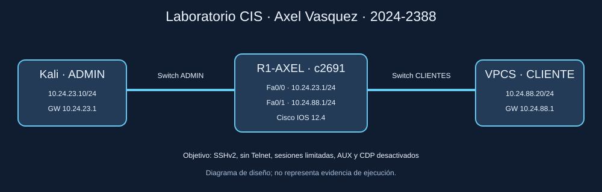
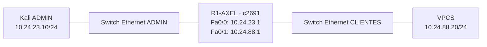

# Video demostrativo

**Pendiente de grabar y subir a YouTube.** Sustituir esta línea por el enlace del video (máximo 10 minutos).

# Hardening de Cisco IOS 12 en GNS3

**Autor:** Axel Enrique Vasquez Peña · **Matrícula:** 2024-2388

**Estado:** materiales preparados; ejecución y evidencias reales pendientes.

## Propósito

Reducir la exposición del plano de administración de un router: retirar Telnet, exigir SSHv2, limitar sesiones inactivas e intentos de autenticación, desactivar AUX y CDP y limpiar conexiones TCP abandonadas. Comprobar que la administración SSH y el enrutamiento siguen funcionando.

Se utiliza un Cisco c2691, Kali Linux, dos switches Ethernet de GNS3 y un cliente VPCS. El análisis automatizado evalúa **diez recomendaciones seleccionadas**, no el cumplimiento completo del benchmark.





## Documentación

1. [Montaje paso a paso](docs/01-montaje.md)
2. [Benchmark, controles y justificación](docs/02-controles-cis.md)
3. [Auditoría, aplicación y recuperación](docs/03-operacion.md)
4. [Pruebas y evidencias](docs/04-pruebas.md)
5. [Video y entrega](docs/05-entrega.md)

## Herramienta

`scripts/cis_ios.py`: auditor propio en Python/Netmiko, basado en CIS Cisco IOS 12 v4.0.0. Recorre los dispositivos del inventario, consulta configuración y estado SSH, genera informes JSON/Markdown, y permite corregir los controles seleccionados. No es CIS-CAT ni una herramienta certificada por CIS.

```bash
python3 -m venv .venv
source .venv/bin/activate
pip install -r requirements.txt
python scripts/cis_ios.py audit --inventory inventory.json
python scripts/cis_ios.py apply --inventory inventory.json
```

Credenciales solicitadas de forma interactiva. Ejecutar desde Kali, con conectividad al router. Los informes y running-configs sanitizados se generan en `reports/` y `configs/running/`; los respaldos originales quedan en `private/`, excluido de Git.

## Alcance y estado verificable

- Benchmark histórico adecuado a IOS 12; referencia oficial: [NIST, checklist 1127](https://ncp.nist.gov/checklist/1127).
- La imagen local encontrada se llama `c2691-[2]advsecurityk9-mz.124-25d 1.image`. Confirmar versión real con `show version`.
- Los diagramas son diseños, las configuraciones iniciales son plantillas y los tests son pruebas de software. No sustituyen evidencia de GNS3.
- Faltan capturas reales, informes del router, running-configs reales, video y número de práctica. Véase [entrega](docs/05-entrega.md).
- IOS 12.4 es una plataforma antigua para este laboratorio aislado; estos ajustes no modernizan sus algoritmos criptográficos.

## Pruebas del software

```bash
python -m unittest discover -s tests -v
```
