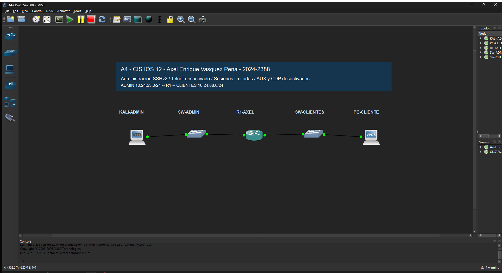

# 4. Pruebas y resultados reales

Ejecución inicial: **11 de noviembre de 2026**. Comprobación tras reinicio: **12 de noviembre de 2026 UTC**. Las pruebas de SSH, Nmap y enrutamiento se ejecutaron desde Kali `10.24.23.10`, contra R1 `10.24.23.1` y VPCS `10.24.88.20`.

## Evidencias por prueba

| Prueba | Resultado observado | Evidencia |
|---|---|---|
| Enrutamiento previo | 5 enviados, 5 recibidos, 0 % pérdida | [Ping inicial](evidencias/ping-audit.txt) |
| Superficie previa | 22 abierto; 23 abierto | [Nmap inicial](evidencias/nmap-audit.txt) |
| Auditoría sin cambios | Diez FAIL; SHA-256 de configuración idéntico antes/después | [Informe](../reports/20261111T172700822966Z-audit/report.md), [hashes](evidencias/audit-no-changes.json) |
| Aplicación | Diez PASS; sin errores; startup guardado | [Informe before/after](../reports/20261111T172747179358Z-apply/report.md) |
| Telnet posterior | 23 cerrado; 22 abierto | [Nmap posterior](evidencias/nmap-apply.txt) |
| SSH funcional | Nueva conexión SSH y enable correctos antes de guardar; segunda ejecución también accedió | [Aplicación](../reports/20261111T172747179358Z-apply/report.json), [idempotencia](../reports/20261111T172835133963Z-idempotence/report.json) |
| Inactividad VTY | Sesión SSH cerrada por el servidor tras 300,59 segundos sin entrada ni keepalive | [Medición real](evidencias/ssh-idle-timeout.json) |
| Inactividad consola | Regreso a `Press RETURN to get started` tras 300,69 segundos sin entrada | [Medición real](evidencias/console-idle-timeout.json) |
| Reintentos SSH | Servidor cerró la misma conexión después de dos contraseñas incorrectas | [Prueba real](evidencias/ssh-authentication-tests.json) |
| Timeout de autenticación | Conexión sin autenticar cerrada por el servidor a los 60,14 segundos | [Prueba real](evidencias/ssh-authentication-tests.json) |
| AUX y CDP | AUX `no exec`; `show cdp`: `% CDP is not enabled` | [Running](../configs/running/after-running-real-sanitizado.cfg), [consola](evidencias/router-after.txt) |
| Keepalives | Ambos comandos presentes en configuración real | [Running](../configs/running/after-running-real-sanitizado.cfg) |
| Enrutamiento posterior | 5 enviados, 5 recibidos, 0 % pérdida; router también alcanzó ambas LAN | [Ping](evidencias/ping-apply.txt), [consola](evidencias/router-after.txt) |
| Persistencia | Diez PASS después de reiniciar; Telnet cerrado. Ping: 4/5 respuestas, primer paquete perdido (20 % en esa prueba) | [Informe](../reports/20261112T043152058666Z-restart/report.md), [Nmap](evidencias/nmap-restart.txt), [ping](evidencias/ping-restart.txt) |
| Idempotencia | Diez PASS y `planned_commands: []` | [Informe JSON](../reports/20261111T172835133963Z-idempotence/report.json) |

## Incidencias y correcciones

1. **Compatibilidad SSH:** Paramiko 5 no negoció el KEX heredado de IOS 12.4. Se fijó Paramiko 3.5.x en el entorno virtual; no se modificó globalmente OpenSSH.
2. **Clonación de Kali:** VMware rechazó crear un clon de una VM encendida. Se desactivó `linked_clone` y se verificó el arranque de la Kali existente desde GNS3.
3. **Perfil de red al reiniciar:** NetworkManager eligió el perfil DHCP antiguo y la primera comprobación falló por conectividad. Se conserva [ese informe](../reports/20261112T042952760586Z-restart/report.md). Se activó `A4-ADMIN-20242388` y se asignó prioridad de autoconexión 100; la siguiente auditoría obtuvo diez PASS.
4. **Consola de GNS3:** reproduce historial al conectar. La prueba de inactividad usa un comando marcador único para descartar mensajes antiguos; un mensaje histórico no se contabiliza como cierre de sesión nuevo.

## Reproducir

En Kali, dentro de `/home/axel/A4-CIS-2024-2388`, activar `.venv` y ejecutar `scripts/cis_ios.py audit` o `apply`, seguido de `nmap -sT -Pn -p 22,23 10.24.23.1` y `ping -c 5 10.24.88.20`. Para autenticación y timeout se incluyen los scripts `probar_autenticacion.py` y `probar_timeout.py`.

Los tests unitarios usan datos sintéticos y verifican el software, no el dispositivo. Las configuraciones iniciales de montaje tampoco se presentan como evidencia: los archivos vinculados arriba son exportaciones de la ejecución real. El cumplimiento indicado es solo de los diez controles seleccionados.
